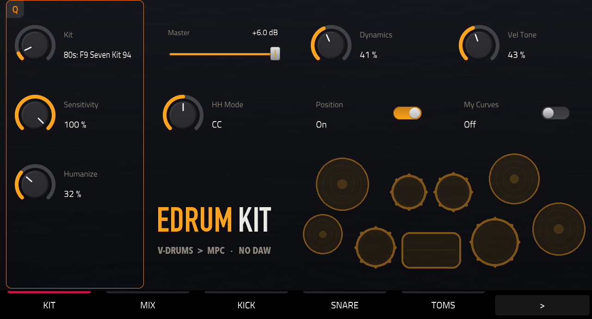

# EDrum Kit — V-Drums straight into a standalone MPC

An instrument plugin for standalone Akai MPC (MPC OS 3.10.1+, built with Akai's MPC Plugin SDK) that lets a
Roland TD-27 module play the MPC's own drum kits — no computer, no DAW.

[▶ Demo on YouTube](https://www.youtube.com/shorts/BulFtb2QcNA)

## What it does
- **Kit menu with every drum kit on the MPC** — the factory expansions (including the 8-layer BFD acoustic kits) and
  your own drum programs. Each TD-27 zone is matched to the right sound in the kit automatically.
- **VH-14D hi-hat**: continuous pedal (closed / half-open / open blend), foot chick and splash, a ringing open hat
  closes when you close the pedal.
- **PD-140DS snare**: centre-to-edge position (CC16) crossfades to the kit's alternate/edge hit; rimshot depth;
  cross-stick. Kits whose only rim sound is a drum-machine click get a proper rimshot (snare + click).
- **CY-18DR ride**: bow / bell split by position (CC17, same split as Superior Drummer's TD-27 preset), edge wash,
  cymbal-grab chokes (poly aftertouch).
- **Dynamics**: Sensitivity maps your real velocity range to the kit's velocity layers; neighbouring layers are blended
  on snare and ride so rolls don't step; repeats never fire the same sample twice.
- **Per-drum Tune / Decay / Tone / Level / Pan** for kick, snare, three toms, hats, two crashes and ride, plus group levels.
- Settings are remembered on the drive, so a new instance starts where you left off.

Defaults follow the TD-27 factory note map (kick 36, snare 38/40/37, toms 48/45/43 + rims 50/47/58,
hi-hat 46/26/42/22/44, crashes 49/55 and 57/52, ride 51/59/53).

## Install
1. MPC OS 3.10.1 or later.
2. Download the zip from **Releases**, unzip, copy the `burgerbarn - VST - EDrum Kit` folder into a folder named
   `VST2 Plugins` at the root of your SD card, USB drive or internal drive.
3. On the MPC: Preferences → Enhancements (Beta) → **Enable Enhancements** and **External Plugin Support**.
4. New track → Plugin → External Plugins → burgerbarn → EDrum Kit. Set the track's MIDI input to your module and
   Monitor to **Merge** (so recorded notes play back).
5. The first time, the plugin scans your drives for kits (a few seconds). Remove and re-add the plugin once so the kit
   menu shows all of them.

Tested on an MPC One Gen 2 (64-bit). The 32-bit build is included but untested.

## Notes
- Reads the MPC's factory `.xtd` kit files directly. That format is not documented by Akai, so a future MPC OS
  update could change it.
- The track icon on the MPC's main page stays the generic plugin icon: the firmware only has artwork for Akai's own plugins.
- Third-party plugins run inside the MPC app without protection; save your work.

## Building
Copy this folder to `plugins/EDrum Kit` inside the [MPC Plugin SDK](https://github.com/inmusic-software/mpc-plugin-builder-sdk),
then `python3 tools/build.py "plugins/EDrum Kit"`. `skin_post.py` draws the page backgrounds (needs Pillow; uses
macOS fonts) and is run on `build/.../Plugin Skins` after building.

Roland, V-Drums, TD-27, VH-14D, PD-140DS and CY-18DR are trademarks of Roland Corporation; MPC and Akai are trademarks
of inMusic. This project is not affiliated with or endorsed by either.

MIT licensed.
